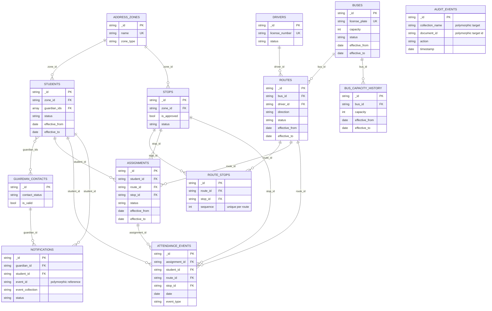

# Entity Relationship Diagram

The diagram covers the 11 core entities and the two supporting history
collections. Relationships show logical references described by the
validators; MongoDB schema validation checks referenced ID shapes but does not
enforce that referenced documents exist.

## Cardinality and special references

- `address_zones` to `students`/`stops`, `buses`/`drivers` to `routes`, and
  each of `students`/`routes`/`stops` to `assignments` are **1:N**.
- `routes` to `stops` is **N:M**, implemented by `route_stops`. The bridge
  has unique indexes on `(route_id, sequence)` and `(route_id, stop_id)`.
- `students` to `guardian_contacts` is **N:M**, represented by the optional
  `students.guardian_ids` array.
- `assignments` to `attendance_events`, `guardians` to `notifications`, and
  `buses` to `bus_capacity_history` are **1:N**.
- `notifications.event_id` is a polymorphic reference selected by
  `event_collection` (`attendance_events`, `assignments`, or `routes`).
  `audit_events` targets any collection selected by `collection_name` and
  `document_id`. These polymorphic relationships cannot be represented as
  ordinary fixed entity-to-entity FKs.
- No **1:1** relationship is defined. Reference existence and cross-field
  agreement are application responsibilities, not validator guarantees.
